# Sci 1 Zone High-Innovation Bearing Fault Diagnosis Model!

After long-term experimental research, we have developed a lightweight bearing fault diagnosis network model!  
This is our innovative model that has not been published yet! If you need it, buy and use it immediately!!!  
Innovation points:  
1. How to perform CNN 2D convolution on one-dimensional fault signal without converting it into a two-dimensional image (which would complicate the process), we creatively propose a method that will be detailed in the accompanying documentation!  
2. We propose a data preprocessing method based on Fast Fourier Transform (FFT) and Variational Mode Decomposition (VMD), which extracts fault features of bearing vibration signals at different frequency ranges, captures the time-frequency characteristics of fault signals, and reduces noise interference. This helps improve the detection and diagnosis effects of bearing faults, enhancing the accuracy and sensitivity of fault diagnosis.  
3. We designed a multi-level attention CNN convolutional pooling model based on channel attention mechanism (SENet), global attention mechanism (GAM-Attention), and cross attention mechanism (CrossAttention). Through clever design, this lightweight network architecture model achieved excellent results from layer 1 to 2!  
With 50 epochs, an accuracy of 100%, using FFT-VMD+multi-level attention CNN lightweight network for classification, the model can fully extract spatial and temporal features as well as frequency domain features of bearing fault signals. The convergence speed is fast, the performance is excellent, and it is currently the highest precision method among previous articles. Innovation also exists!!!  
Environment: Python 3.9 PyTorch 1.8 and above are required  
Note: For this product, we also provide a model explanation (for learning network structure) and parameter adjustment guidance! Students who need to complete their graduation projects or write papers should definitely check out this module, rich in innovation, high in performance!!  
Preface
This article preprocesses the data for bearings based on the data from Case Western Reserve University (CWRU), including a rapid Fourier transform (FFT) and Vector Mode Decomposition (VMD) for data preprocessing. Finally, it implements a lightweight CNN architecture model for fault classification using multi-level attention through Python. For more detailed information about CWRU's bearing data, please refer to the following:
Python-Case Western Reserve University (CWRU) Bearing Data Interpretation and Classification Processing
1. Overall Model Architecture
Preprocessing:
- One-dimensional fault signals are processed through FFT transformation and VMD decomposition, and then the results are stacked.
Branch 1: Through the SENet-based CNN2d convolutional pooling network with channel attention mechanism, adaptively adjusting the weights of channel features allows the model to automatically learn the importance of different channels, extracting important features related to faults in the bearing fault signal;
Branch 2: The preprocessed data is also processed through the GAM-Attention-based CNN2d convolutional pooling network, introducing a global attention mechanism throughout the feature map. By weighting all positional features, the model can focus more on important feature areas, enhancing its ability to perceive key details in bearing fault signals;
Then, both branches extract global spatial and local features, and fuse them through cross attention mechanisms. Cross-attention mechanisms are introduced between multiple convolutional layers, allowing for better integration of feature representations at different levels by introducing interlayer information interaction, focusing on important features to improve model performance and generalization capabilities.
Channel Attention Mechanism
Squeeze-and-Excitation Networks
Global Attention Mechanism
2. Preprocessing of Bearing Fault Data
2.1 Import Data
Reference to previous articles, preprocessing for fault classification 10 is carried out. The dataset for Fault Classification 10: 
- train_set, val_set, test_set are divided according to a ratio of 7:2:1 for training set, validation set, and test set, respectively, with data saved at the end.
2.2 Fault FFT transformation visualization
2.3 Fault VMD decomposition visualization
2.4 Preparation of feature preprocessing datasets for fault data
3 Cross Attention Mechanism
3.1 Concept of Cross Attention
In the Transformer architecture, an attention mechanism that mixes two different embedding sequences is introduced.
Both sequences must have the same dimensionality.
The two sequences can be of different patterns (e.g., text, sound, image).
One sequence serves as input Q, defining the output sequence length, while the other provides input K&V.
3.2 Cross-attention algorithm
With two sequences S1 and S2,
Calculate K and V for S1
Calculate Q for S2
Compute the attention matrix based on K and Q
Apply V to the attention matrix
Output sequence length consistent with S2
During the fusion process, we use the local spatial features extracted by CNN2d based on channel attention mechanism SENet as the query sequence, and global spatial features extracted by CNN2d based on global attention mechanism GAM-Attention as the key-value pair sequence. By calculating the attention weights between the query sequence and the key-value pair sequence, we can model the degree of association between different features.
4 Classification Network Model Based on CNN 2D Convolution Multi-level Attention Mechanism
4.1 Define network model
4.2 Set parameters and train the model
50 epochs, accuracy 100%, the classification effect of FFT-VMD+ multi-level attention based CNN is significant. Fast Fourier Transform (FFT) and Variational Mode Decomposition (VMD) can effectively mine multi-scale features from signals. The innovative model can fully extract global spatial and local features of bearing fault signals, with fast convergence speed, superior performance, high accuracy, and cross-attention mechanism can model the correlation degree between different features. It can extract important features for model recognition from frequency domain, time domain, and spatial features of fault signals, with obvious effects and high innovation!
4.3 Model Evaluation
Accuracy, Precision, Recall, F1 Score
Fault Classification Confusion Matrix:
Previously outstanding content:
Python-Kaisi University (CWRU) Bearing Data Interpretation and Classification Process
Python Bearing Fault Diagnosis (Part I): Short-time Fourier Transform STFT
Python Bearing Fault Diagnosis (Part II): Continuous Wavelet Transform CWT
Python Bearing Fault Diagnosis (Part III): Empirical Mode Decomposition EMD
Pytorch-LSTM Bearing Fault One-Dimensional Signal Classification (Part I)
Pytorch-CNN Bearing Fault One-Dimensional Signal Classification (Part II)
Pytorch-Transformer Bearing Fault One-Dimensional Signal Classification (Part III)
Python Bearing Fault Diagnosis (Part IV): Based on EMD-CNN Fault Classification
Python Bearing Fault Diagnosis (Part V): Based on EMD-LSTM Fault Classification
Python Bearing Fault Diagnosis (Part VI): Based on EMD-Transformer Fault Classification
Python Bearing Fault Diagnosis (Part VII): Based on EMD-CNN-LSTM Fault Classification
Python Bearing Fault Diagnosis (Part VIII): Based on EMD-CNN-GRU Parallel Model Fault Classification
The bearing fault recognition model based on FFT + CNN - BiGRU-Attention for time and frequency domain feature attention fusion.
The bearing fault recognition model based on FFT + CNN - Transformer for time and frequency domain feature fusion.
Python bearing fault diagnosis (IX) Based on VMD+CNN-BiLSTM for fault classification.
Python bearing fault diagnosis (X) Based on VMD+CNN-Transformer for fault classification.
Python bearing fault diagnosis (XI) Based on VMD+CNN-BiGRU-Attention for fault classification.
Cross attention fusion of time and frequency domain features in the bearing fault recognition model based on FFT + CNN - BiLSTM-CrossAttention.
Cross attention fusion of time and frequency domain features in the bearing fault recognition model based on FFT + CNN-Transformer-CrossAttention.
Python bearing fault diagnosis tutorial.
Python bearing fault diagnosis (13) Super machine learning recognition model based on fault signal feature extraction.
Python bearing fault diagnosis (14) Highly innovative fault recognition model.
Python bearing fault diagnosis (15) One-dimensional fault signal recognition model based on CNN-Transformer.

## Images

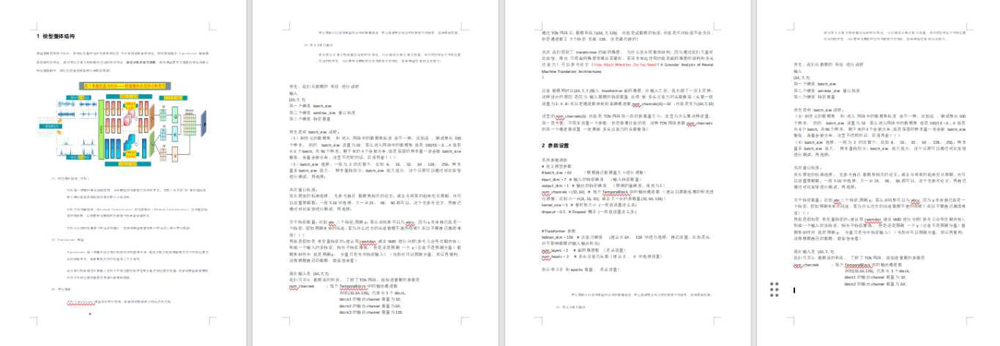
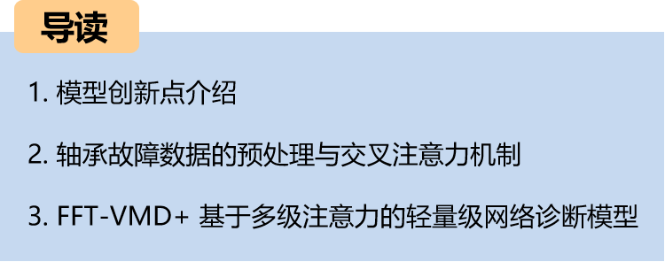
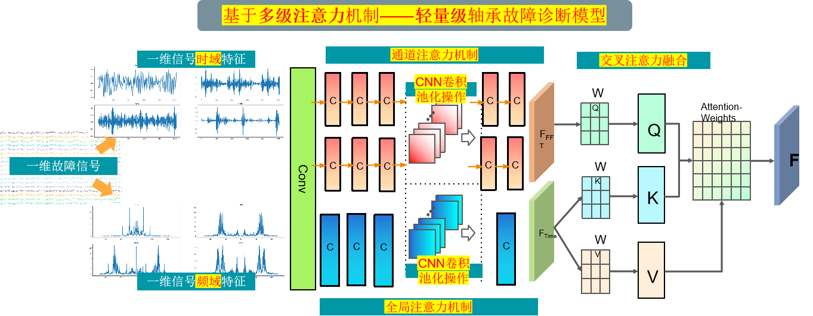
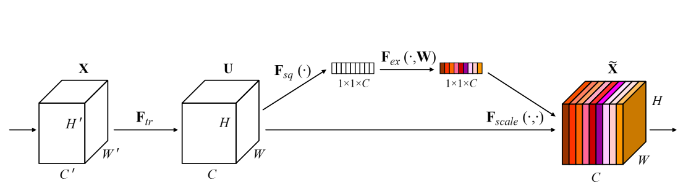
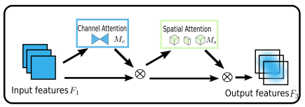

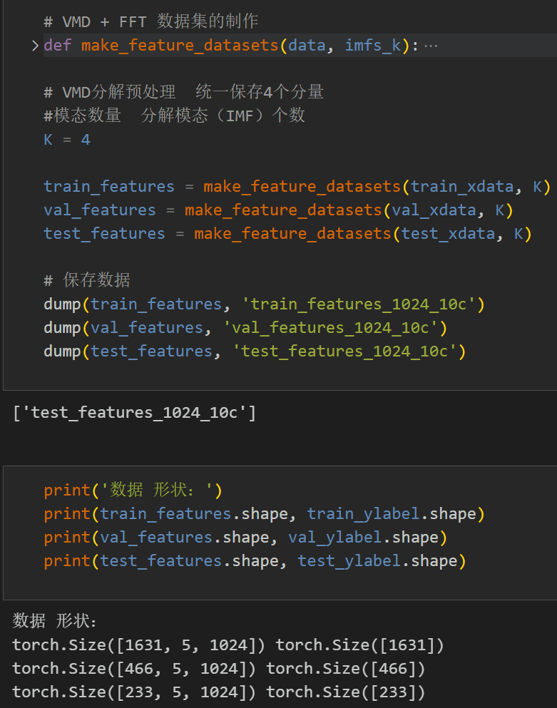

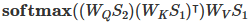
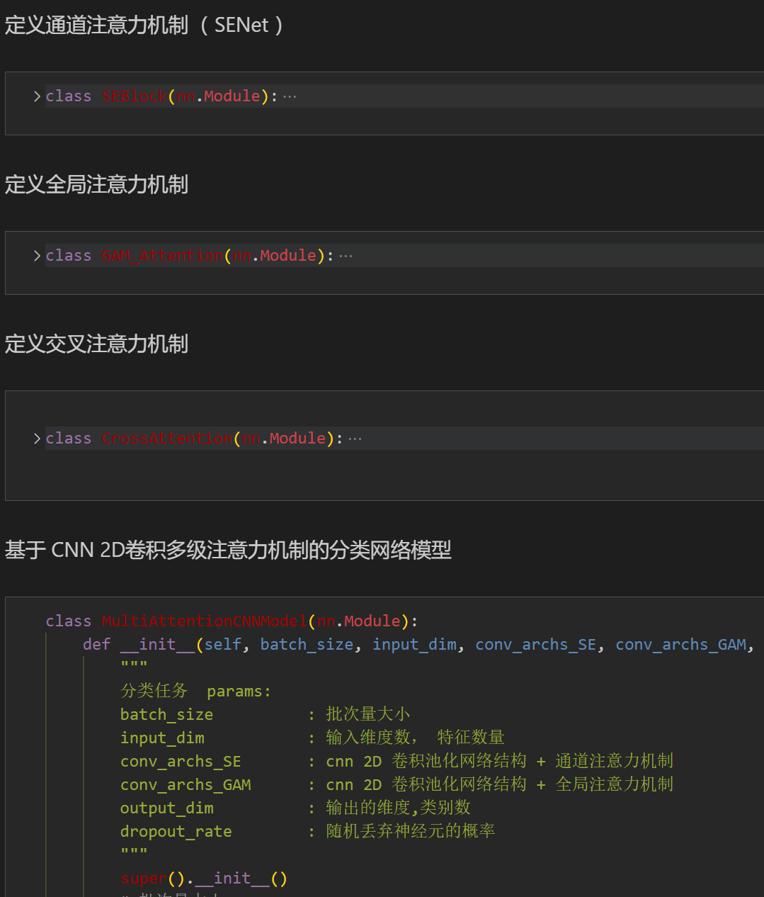
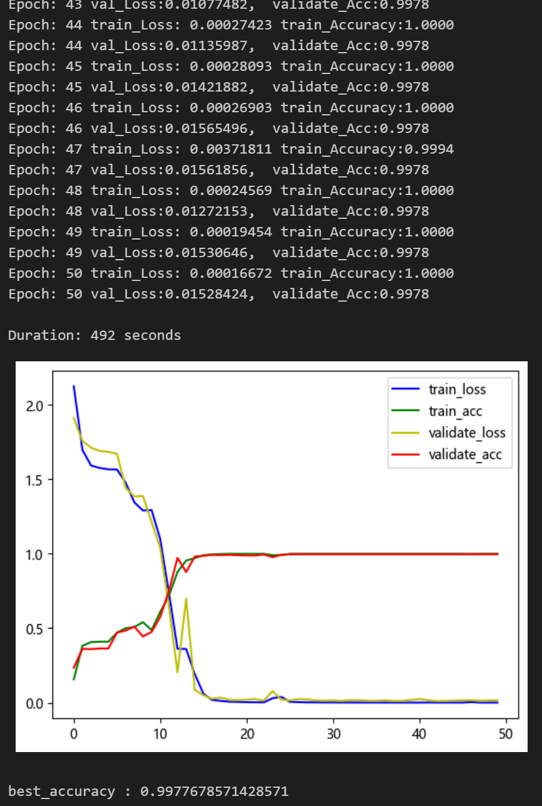
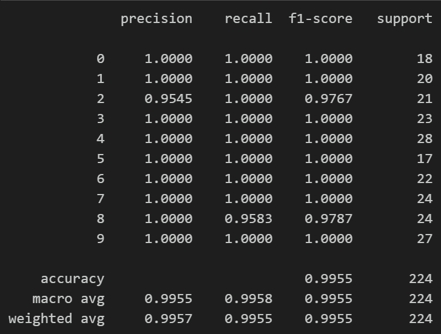
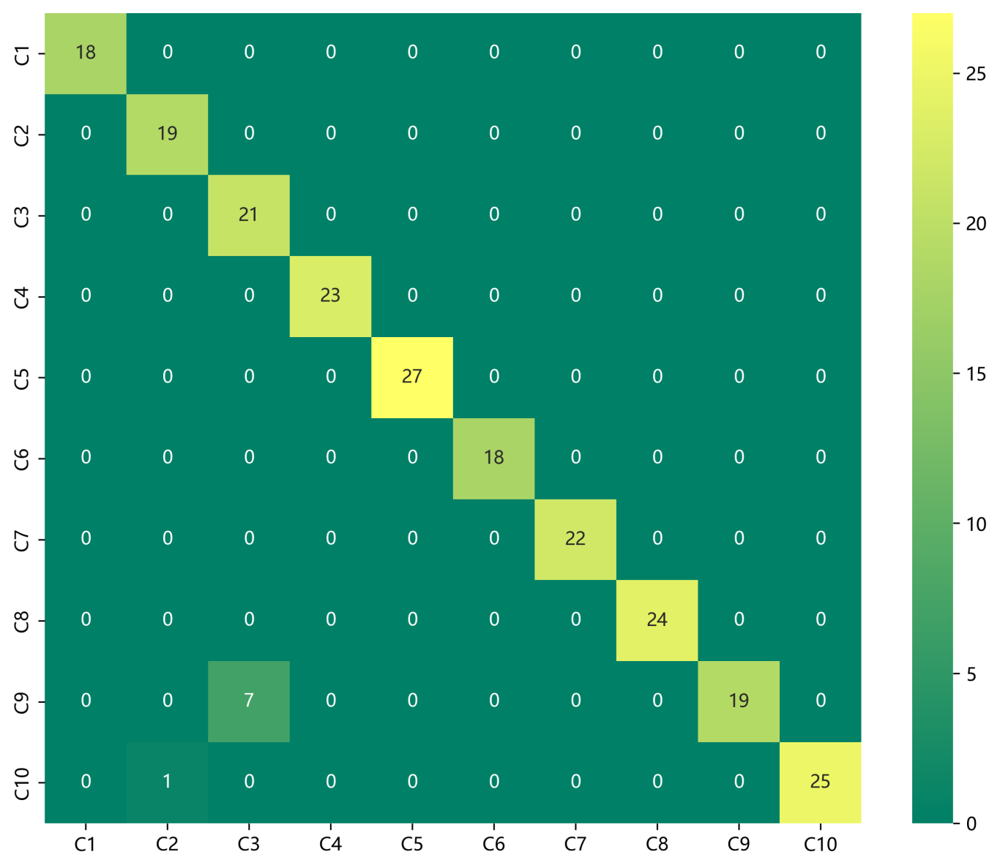
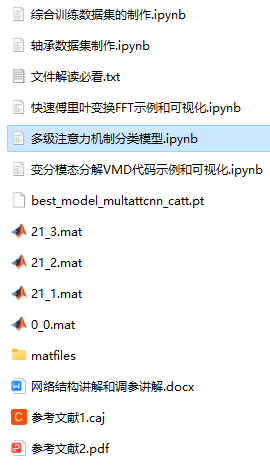

<!-- PAYMENT_BLOCK -->

## Get this dataset

- Payment link (Stripe): [Buy now](https://buy.stripe.com/3cs8yP7sY87d0vu9AB)
- Payment QR code: 

<!-- /PAYMENT_BLOCK -->
